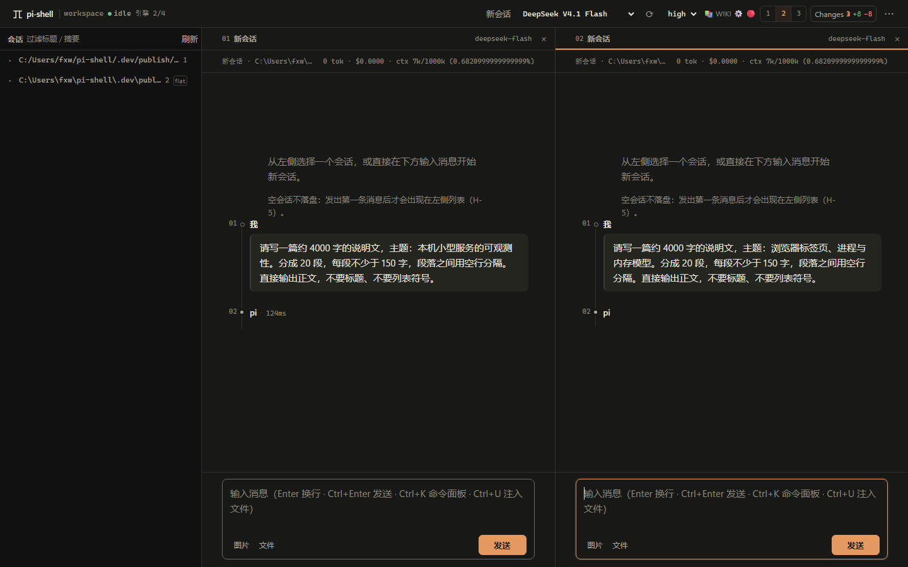
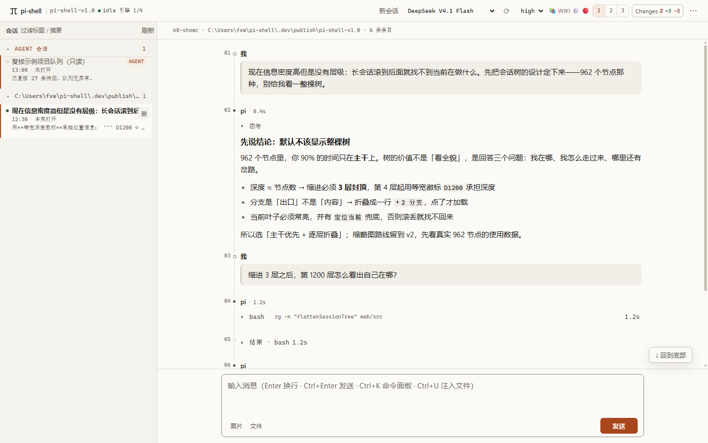
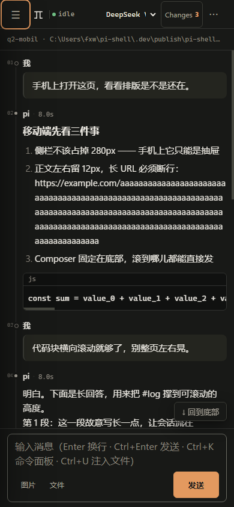

English · **[简体中文](README.md)**

# pi-shell

> A thin, disposable browser shell for your local **pi coding agent** — no second engine, no copied data, uninstall = delete the folder.

**License MIT** · **Node.js ≥ 22.19** · **zero dependencies / zero build** · **tests 216/216** · **platform: tested on Windows 11**



## Screenshots

| Desktop · single column (light) | Phone · 390px |
|:---:|:---:|
|  |  |

Both are **real running-app screenshots** (generated by the evidence scripts in [`scripts/evidence/`](scripts/evidence) driving fixture sessions — not mockups); visual spec lives in [`docs/DESIGN-SYSTEM.md`](docs/DESIGN-SYSTEM.md).

## What problem does it solve

You've got pi working in your terminal. Then:

- **You want to keep an eye on it without babysitting the terminal** — you switch to your editor, come back, and the streaming output has long scrolled past; where did it get to?
- **You want to keep watching from your phone**, maybe even send a follow-up message.
- **You want three tasks side by side**, each in its own session, each generating on its own.
- **You don't want to adopt a whole new engine for any of this** — another agent, another copy of your data, another resident service.

pi-shell's answer: **a thin browser shell around pi**. The browser does the "watching and typing"; the engine is still the one pi on your machine:

- **No second engine** — the page has no built-in agent; every column drives a `pi --mode rpc` process.
- **No copied data** — it reads and writes pi's own config and sessions under `~/.pi/agent`.
- **Disposable** — stop the process, delete the folder; pi and its data are untouched.

## Why it's worth a try

- **Clone and run** — the bridge is plain Node ESM (no `node_modules`, no framework, no build step); the frontend is a native-ESM web page (no bundler, no CDN, zero remote resources).
- **Localhost by default** — listens on `127.0.0.1` only; binding `0.0.0.0` is refused outright. Phone access goes through Tailscale dual-stack (the same port listens on both `127.0.0.1` and `100.x`, traffic stays on the encrypted tailnet).
- **Real parallel columns** — one page, 1–3 columns, each with its own engine, all free to **generate at the same time**; switching windows or closing the tab **never aborts** a running turn, and missed output is replayed when you come back.
- **Stream survives disconnects** — one SSE event stream per column, automatic retry with sequence-number replay of the unwritten tail; after a bridge restart it re-attaches to your last session (model and thinking level included), and if it can't, it says so and blocks sending.
- **Uninstall = delete the folder** — it modifies nothing under `~/.pi/agent` (except what pi itself writes at runtime: `settings.json` / `models-store.json` / `state/` / `sessions/` / `logs/`).

## Meet pi first

pi-shell is a shell; pi comes first. **[pi](https://pi.dev)** (npm package [`@earendil-works/pi-coding-agent`](https://www.npmjs.com/package/@earendil-works/pi-coding-agent), source at [earendil-works/pi](https://github.com/earendil-works/pi), MIT) is an AI coding agent that lives in your terminal: run `pi` in any project directory and the model reads code, edits files, and runs commands; it also supports extensions / skills / themes.

How pi-shell relates to pi — **one shared `~/.pi/agent`** (config, extensions, skills, models and sessions are all reused):

```
browser (http://127.0.0.1:7788)
   │  HTTP commands       GET /api/events (SSE stream)
   ▼
bridge (Node ESM, zero deps)
   │  stdin/stdout JSONL
   ▼
pi --mode rpc            ← uses your ~/.pi/agent (extensions/skills/models/sessions)
```

**Why pi must be installed first**: pi-shell is only the translation layer between the browser and pi — it bundles no engine and installs none for you. No working pi, no working pi-shell.

## Installation (from a bare machine to the browser, each step verified)

### Step 0 · Check Node.js

```bash
node -v
```

Anything ≥ **22.19** works. No Node yet? Get it from <https://nodejs.org> (pi's official installer can also install Node for you if needed).

### Step 1 · Install pi

macOS / Linux:

```bash
curl -fsSL https://pi.dev/install.sh | sh
```

Windows (PowerShell):

```powershell
powershell -c "irm https://pi.dev/install.ps1 | iex"
```

Or on any platform (when you already have Node):

```bash
npm install -g --ignore-scripts @earendil-works/pi-coding-agent
```

To upgrade pi later, run `pi update`. See <https://pi.dev> for details.

✓ **Verify**: run `pi` in any directory — you land in pi's interactive UI.

### Step 2 · Configure a model

Inside pi, type `/login`: pick a built-in provider for one-click sign-in, or enter your own API key.

✓ **Verify**: send a line in pi (say hello) and get a model reply.

### Step 3 · Start pi-shell

```bash
git clone https://github.com/NNurphy/pi-shell
cd pi-shell
node bridge/src/index.mjs
```

Open <http://127.0.0.1:7788> in a browser.

✓ **Verify**: the page loads and the sidebar lists your pi sessions (grouped by project).

**One-click on Windows**: double-click (or run) `scripts\start-pi-shell.cmd` —

- single instance: if it's already running, it just opens the browser;
- opens the browser ~3s after the bridge starts;
- restarts the bridge on crash (1s / 2s / 4s backoff, at most 3 per 5 minutes);
- closing the window stops everything — nothing stays resident.

## Phone access (Tailscale)

Prerequisite: install [Tailscale](https://tailscale.com) on both the PC and the phone, signed into **the same account**.

- **Path A (recommended, Windows)**: start via `scripts\start-pi-shell.cmd` — the script detects your tailnet and automatically listens dual-stack (`127.0.0.1` + `100.x` on the same port). On the phone, open the address shown in the `mobile over Tailscale:` line of the launcher window.
- **Path B (any platform / troubleshooting)**: run `powershell -NoProfile -ExecutionPolicy Bypass -File scripts\tailscale-setup.ps1` — read-only dry-run by default, printing your tailnet address and a checklist; add `-Apply` only when you're sure, which adds a firewall rule (inbound TCP to the bridge port from `100.64.0.0/10` only, reversible).

**Security boundary**: phone traffic stays on the encrypted tailnet and never touches the public internet; pi-shell binds `127.0.0.1` by default and refuses `0.0.0.0` outright (unless you explicitly set `PI_SHELL_ALLOW_LAN=1`).

## Getting-started notes (know these, avoid the traps)

- **Columns and background** — click `2` / `3` in the top bar (max 3 columns, 4 engines by default). **Switching windows or closing the tab never aborts** a running turn — come back anytime, unwritten output is replayed.
- **Watching ≠ sending** — opening a session first renders it from disk (≤2s, zero side effects); you must "take over" before you can send (~3s, because pi restarts MCP on every session switch).
- **Never open the same session in a terminal and pi-shell at once** — pi has no session locking and pi-shell cannot detect it; all it can do is warn and back up (see `docs/03-design.md` §9).
- **If you start the bridge from a script, ignore its stdio** — logs mirror to stderr only on a TTY; piping stdio without consuming it will deadlock it (H-15).

## How it works

```
browser (http://127.0.0.1:7788)
   │  HTTP commands       GET /api/events (SSE stream)
   ▼
bridge (Node ESM, zero deps)
   │  stdin/stdout JSONL
   ▼
pi --mode rpc            ← uses your ~/.pi/agent (extensions/skills/models/sessions)
```

Three layers, one job each: the **browser** renders the UI (native ESM, zero build, zero remote resources); the **bridge** is a zero-dependency Node process translating HTTP/SSE into pi's stdin/stdout JSONL RPC — it runs no model itself; **pi** is still the one on your machine, reusing all of `~/.pi/agent`.

Security posture: `127.0.0.1`-only by default (binding `0.0.0.0` refuses to start); no data modified except pi's own runtime writes; zero remote resources in the page.

## FAQ

<details>
<summary><b>Port 7788 is taken</b></summary>

Set the <code>PI_SHELL_PORT</code> environment variable to another port (e.g. 7790) before starting; <code>scripts\start-pi-shell.cmd</code> honors it too.

</details>

<details>
<summary><b>How do I update pi-shell</b></summary>

<code>git pull</code> inside the clone, then restart (close the launcher window / Ctrl+C, start again). The bridge is stateless — an upgrade is just a swap.

</details>

<details>
<summary><b>How do I uninstall</b></summary>

Close the launcher window (or end the node process) and delete the clone folder. <code>~/.pi/agent</code> belongs to pi and is untouched.

</details>

<details>
<summary><b>Which platforms are supported</b></summary>

Developed and tested on Windows 11 + Node 24; other platforms are not systematically tested (the bridge and frontend are plain cross-platform Node/browser code). Feedback welcome.

</details>

## Documentation map

| I want to… | Go to |
|---|---|
| **Get it running** | “Installation” above |
| **Use it** (UI/shortcuts/FAQ) | [`docs/USER-GUIDE.md`](docs/USER-GUIDE.md) |
| **Know the design** (layers/endpoints/invariants) | [`docs/ARCHITECTURE.md`](docs/ARCHITECTURE.md) |
| **Change a feature** (where + what to run) | [`docs/MAP.md`](docs/MAP.md) |
| **Verify it** (what, how long, criteria) | [`docs/06-traceability-and-test.md`](docs/06-traceability-and-test.md) |
| **Troubleshoot / release / roll back** | [`docs/RUNBOOK.md`](docs/RUNBOOK.md) |
| **See what's in this release** | [`CHANGELOG.md`](CHANGELOG.md), [`RELEASE-NOTES.md`](RELEASE-NOTES.md), [`docs/WHATS-NEW.md`](docs/WHATS-NEW.md) |
| **See proof it really ran** | [`scripts/evidence/`](scripts/evidence) (replayable scripts, fixture sessions only) |
| **Bail out** | stop process → delete the clone → `git clone` again → `cd bridge && npm test` (expect 216/216) |

More background (Chinese): contract & measured facts (`docs/03-design.md`, the single source of truth), requirements & acceptance (`docs/02-prd.md`), decision log (`docs/05-decisions-and-open-questions.md`), glossary (`docs/00-glossary.md`), product brief (`docs/PRODUCT-BRIEF.md`), visual system (`docs/DESIGN-SYSTEM.md`).

## Feedback

- Problems with pi-shell itself (UI, bridge, docs): issues are welcome → <https://github.com/NNurphy/pi-shell/issues>
- Problems with the pi engine (model behavior, RPC protocol, installation): please go upstream → <https://github.com/earendil-works/pi>

## License

MIT · Copyright (c) 2026 NNurphy · see [LICENSE](LICENSE)
