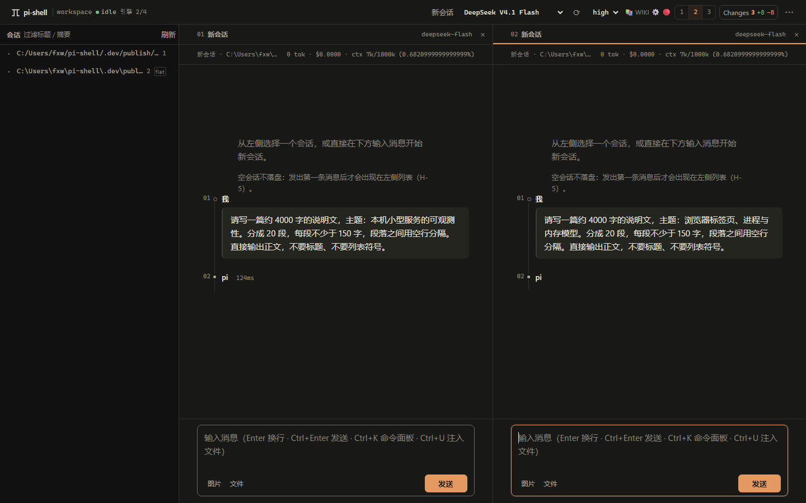
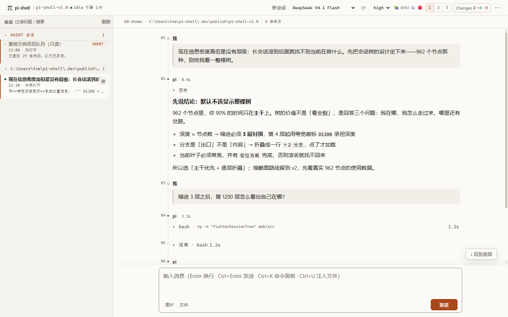
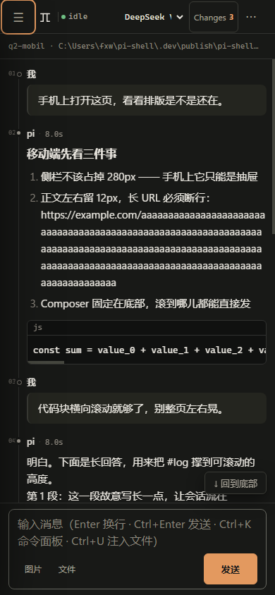

**简体中文** · [English](README.en.md)

<p align="center"></p>

# pi-shell

> 给本机的 **pi 编码代理**加一层轻薄的浏览器壳——不装第二套引擎、不复制数据、卸载就是删目录。

[](LICENSE)
[](https://nodejs.org)
[](bridge/test)
[](bridge/package.json)
[](#常见问题)



## 截图

| 桌面 · 单列会话流（亮色） | 手机 · 390px |
|:---:|:---:|
|  |  |

以上均为**真实运行截图**（由开发期取证脚本驱动夹具会话生成，非设计稿）；视觉规格见 [`docs/DESIGN-SYSTEM.md`](docs/DESIGN-SYSTEM.md)。

## 它解决什么问题

在终端里用 pi 干活，这些时刻最难受：

1. **想接着聊三天前的对话**：终端里 `pi --resume` 能找回历史会话，但要在文本列表里翻、一次进一个，上下文靠向上滚屏回看。pi-shell：侧栏会话列表点击即达，整段对话以树形结构展开，2 秒内看清全貌；点「接管」，约 3 秒后就能继续发消息。
2. **人一走任务就断**：终端窗口关了、断网了，正在跑的回合就没了。pi-shell：切走或关掉标签页，**正在跑的回合继续执行**，回来时未落盘的输出自动补齐。
3. **一次只能盯一件事**：终端一个窗口一个任务，排队等。pi-shell：一页 3 列并行 + 多标签页，每个会话独立引擎，同时跑互不阻塞。
4. **出门在外抓瞎**：想看 AI 跑到哪了，但电脑不在手边。pi-shell + Tailscale：手机浏览器直连家里电脑（走 tailnet 加密通道，不出公网）。
5. **大会话变成文字瀑布**：几千条消息的会话在终端里没法导航。pi-shell：树形视图定位到任意分支；每轮的「变更面板」直接看这轮改了哪些文件。

## 为什么值得试

- **clone 即用**：桥是纯 Node ESM——没有 `node_modules`、没有框架、没有构建步骤；前端是原生 ESM 网页——没有打包器、没有 CDN、零远程资源。
- **默认不出本机**：只监听 `127.0.0.1`；要绑 `0.0.0.0` 直接拒绝启动。手机访问走 Tailscale 双栈（同一端口同时监听 `127.0.0.1` + `100.x`，只走 tailnet 加密通道）。
- **真正的多列 / 多标签页并行**：
  - **多列**：一个页面最多 3 列，每列一个独立会话、独立引擎，可同时生成互不打断；
  - **多标签页**：还可以再开标签页，**各页布局独立、互不干扰**——3 列只是单页布局上限，不是总量上限；
  - **共享引擎池**：所有标签页的所有列共享一个引擎池，默认上限 4 个并发引擎；机器性能好可以调大——设置环境变量 `PI_SHELL_MAX_ENGINES=8` 再启动即可；
  - **自动让位**：空闲 60 秒的引擎自动回收给新任务腾位；**正在输出的引擎绝不被回收**。
- **断线不丢流**：每列一条 SSE 事件流，断线自动重试、按序号回放未落盘的尾巴；重启桥后也能自动接回上次的会话（含模型与思考级别），接不回来会明确提示并拦住发送。
- **卸载 = 删目录**：不修改 `~/.pi/agent`（pi 自身运行期写入的 `settings.json` / `models-store.json` / `state/` / `sessions/` / `logs/` 除外）。

## 先认识 pi

pi-shell 是壳，先有 pi。**[pi](https://pi.dev)**（npm 包 [`@earendil-works/pi-coding-agent`](https://www.npmjs.com/package/@earendil-works/pi-coding-agent)，源码 [earendil-works/pi](https://github.com/earendil-works/pi)，MIT 协议）是一个跑在终端里的 AI 编码代理：在任意项目目录运行 `pi`，模型就能读代码、改文件、执行命令；还支持 extensions / skills / themes 自定义。

pi-shell 与 pi 的关系——**同一份 `~/.pi/agent`**（配置、扩展、技能、模型、会话全部复用）：

```
浏览器 (http://127.0.0.1:7788)
   │  HTTP 命令          GET /api/events (SSE 事件流)
   ▼
bridge（Node ESM，零依赖）
   │  stdin/stdout JSONL
   ▼
pi --mode rpc           ← 使用你的 ~/.pi/agent（扩展/技能/模型/会话）
```

**为什么必须先装好 pi**：pi-shell 只做「浏览器 ↔ pi」之间的翻译层，不内置也不代装引擎。pi 没装好，pi-shell 无从工作。

## 安装（从零到浏览器可用，每步带验证）

### Step 0 · 检查 Node.js

```bash
node -v
```

版本 ≥ **22.19** 即可。没有 Node？去 <https://nodejs.org> 安装（pi 的官方安装器在需要时也可以代装 Node）。

> 本仓库只发布运行时（`bridge/`、`web/`）与安装脚本。开发期的测试套件与证据脚本（起假引擎、驱动浏览器抓图的那些）不上公仓——`bridge/test/` 下的单测是自带的，`cd bridge && npm test` 可复跑。

### Step 1 · 安装 pi

macOS / Linux：

```bash
curl -fsSL https://pi.dev/install.sh | sh
```

Windows（PowerShell）：

```powershell
powershell -c "irm https://pi.dev/install.ps1 | iex"
```

或者任一平台（已有 Node 时）：

```bash
npm install -g --ignore-scripts @earendil-works/pi-coding-agent
```

之后升级 pi 用 `pi update`。详见 <https://pi.dev>。

✓ **验证**：在任意目录运行 `pi`，能进入 pi 的交互界面。

### Step 2 · 配置模型

进入 pi 后输入 `/login`：选择内置 provider 一键连接，或填入你自己的 API key。

✓ **验证**：在 pi 里发一句话（比如打个招呼），能得到模型回复。

### Step 3 · 启动 pi-shell

```bash
git clone https://github.com/NNurphy/pi-shell
cd pi-shell
node bridge/src/index.mjs
```

浏览器打开 <http://127.0.0.1:7788>。

✓ **验证**：页面加载后，侧栏列出你 pi 的会话（按项目分组）。

**Windows 一键方式（推荐）**：跑一次安装器，在桌面生成带 LOGO 图标的 `pi-shell` 快捷方式（托盘模式）：

```powershell
powershell -NoProfile -ExecutionPolicy Bypass -File scripts\setup-windows.ps1
```

之后双击桌面 **`pi-shell`** 快捷方式启动：

- **托盘模式**：无常驻终端窗口；右下角托盘图标右键控制（打开页面 / 重启 / 停止），悬停可实时看引擎数（如 `引擎 2/4`）；
- 单实例：托盘已在时再双击快捷方式不会起第二个桥（想回页面：托盘右键「打开页面」或直接访问 7788）；
- 启动约 3 秒后自动打开浏览器；
- 桥崩溃自动重启（1s / 2s / 4s 退避，5 分钟内最多 3 次）；
- 停止 = 托盘右键「停止」，无后台驻留。

**控制台模式（调试入口）**：双击（或命令行运行）`scripts\start-pi-shell.cmd`——保留一个启动窗口，可看实时日志与 Tailscale 提示行；关闭窗口即全部停止。桌面上的「重启 pi-shell」快捷方式同样由安装器生成。

## 手机访问（Tailscale）

前提：本机与手机都安装 [Tailscale](https://tailscale.com) 并用**同一账号**登录。

- **路径 A（推荐，Windows）**：托盘模式 / `scripts\start-pi-shell.cmd` 启动——脚本检测到本机在 tailnet 上就自动双栈监听（`127.0.0.1` + `100.x` 同端口）。控制台模式下手机浏览器打开启动窗口里 `mobile over Tailscale:` 提示的地址即可；托盘模式看不到启动窗口时，用路径 B 查地址。
- **路径 B（任意平台 / 排查）**：跑 `powershell -NoProfile -ExecutionPolicy Bypass -File scripts\tailscale-setup.ps1`——默认只读（dry-run），打印本机 tailnet 地址与排查清单；确认需要时加 `-Apply` 才会添加防火墙入站规则（仅放行 `100.64.0.0/10` 到桥端口，可一键回滚）。

**安全边界**：手机流量只走 tailnet 加密通道，不出公网；pi-shell 默认只绑 `127.0.0.1`，`0.0.0.0` 监听被直接拒绝（除非显式设置 `PI_SHELL_ALLOW_LAN=1`）。

## 上手要点（先知道，少踩坑）

- **多列与后台**：顶栏点 `2` / `3` 开列（列最多 3、引擎默认最多 4）。**切走窗口或关掉标签页不会中止**正在跑的回合——回来接着看，未落盘的输出自动补齐。
- **多开标签页是受支持的用法**：3 列只是单页布局上限——再开（或复制）一个标签页就是一套独立布局，互不干扰；需要更多并发引擎时，启动前设 `PI_SHELL_MAX_ENGINES=<数>`（默认 4）。
- **能看 ≠ 能发**：打开一个会话，先读文件渲染（≤2 秒、零副作用）；点「接管」后才能发送（约 3 秒，因为 pi 每次切换会话要重启 MCP）。
- **不要和终端同开同一个会话**：pi 没有会话锁，pi-shell 检测不到，只能提示 + 备份（见 `docs/03-design.md` §9）。
- **脚本方式启动请忽略 stdio**：桥的日志只在 TTY 上镜像到 stderr；用管道接管 stdio 又不消费，会卡死（H-15）。

## 工作原理

```
浏览器 (http://127.0.0.1:7788)
   │  HTTP 命令          GET /api/events (SSE 事件流)
   ▼
bridge（Node ESM，零依赖）
   │  stdin/stdout JSONL
   ▼
pi --mode rpc           ← 使用你的 ~/.pi/agent（扩展/技能/模型/会话）
```

三层各司其职：**浏览器**负责界面（原生 ESM、零构建、零远程资源）；**bridge** 是一个零依赖的 Node 进程，把 HTTP/SSE 翻译成 pi 的 stdin/stdout JSONL RPC，自己不跑模型；**pi** 还是你本机那一个，配置、扩展、技能、会话全部沿用 `~/.pi/agent`。

安全面：默认只监听 `127.0.0.1`（绑 `0.0.0.0` 直接拒绝启动）；除 pi 自身运行期的写入外不改任何数据；网页零远程资源。

## 常见问题

<details>
<summary><b>端口被占了（7788）</b></summary>

启动前把环境变量 <code>PI_SHELL_PORT</code> 设成别的端口（如 7790）再启动；<code>scripts\start-pi-shell.cmd</code> 同样识别该变量。

</details>

<details>
<summary><b>一页最多 3 列，引擎却默认 4 个，数字对不上？</b></summary>

对得上——单页 3 列 × 多标签页 → 同时活跃的会话数，由引擎池上限决定（默认 4，可通过 <code>PI_SHELL_MAX_ENGINES</code> 调大）。

</details>

<details>
<summary><b>打开超大历史会话，一直「接管中」最后超时</b></summary>

v1.2.0 起**接管不再依赖「一行装下整个会话」的 RPC**：打开 / 接管 / 断线恢复都直接读会话文件，会话多大都不影响接管速度（十几 MB 的老会话也在百毫秒级接上）。升级后仍卡在「接管中」的，先看桥日志有没有 <code>pi_line_skipped reason=overlong</code>：这只剩「单行超过 32MiB」一种可能，启动前设 <code>PI_SHELL_MAX_LINE_BYTES</code>（字节数，如 <code>67108864</code> = 64MiB）再启动即可。

</details>

<details>
<summary><b>如何更新 pi-shell</b></summary>

在 clone 目录里 <code>git pull</code>，然后重启（托盘右键「重启」，或关掉启动窗口 / Ctrl+C 后再启动）。桥无状态，升级即换新。

</details>

<details>
<summary><b>如何卸载</b></summary>

托盘右键「停止」（或关闭启动窗口 / 结束 node 进程），跑 <code>powershell -NoProfile -ExecutionPolicy Bypass -File scripts\setup-windows.ps1 -Remove</code> 移除桌面快捷方式，然后删除整个 clone 目录。`~/.pi/agent` 属于 pi，不受影响。

</details>

<details>
<summary><b>支持什么平台</b></summary>

开发与实测环境为 Windows 11 + Node 24；其他平台未做系统测试（桥与前端均为跨平台的纯 Node / 浏览器代码）。欢迎反馈。

</details>

## 文档地图

| 我想… | 去哪 |
|---|---|
| **跑起来** | 本页「安装」 |
| **会用**（界面/快捷键/常见问题） | [`docs/USER-GUIDE.md`](docs/USER-GUIDE.md) |
| **知道它怎么设计**（三层/端点/不变量） | [`docs/ARCHITECTURE.md`](docs/ARCHITECTURE.md) |
| **改某个功能**（改哪里+跑什么验证） | [`docs/MAP.md`](docs/MAP.md) |
| **验收**（跑什么、多久、判据） | [`docs/06-traceability-and-test.md`](docs/06-traceability-and-test.md) |
| **排障 / 发布 / 回滚** | [`docs/RUNBOOK.md`](docs/RUNBOOK.md) |
| **这个版本有什么** | [`CHANGELOG.md`](CHANGELOG.md)、[`RELEASE-NOTES.md`](RELEASE-NOTES.md)、[`docs/WHATS-NEW.md`](docs/WHATS-NEW.md) |
| **断言"真跑过"** | [`bridge/test/`](bridge/test)（单测全部用夹具会话，`cd bridge && npm test` 应 **226/226**） |
| **坏了怎么退** | 停进程 → 删 clone 目录 → 重新 `git clone` → `cd bridge && npm test`（应 226/226） |

更多背景：契约与实测事实（`docs/03-design.md`，唯一事实来源）、需求与验收（`docs/02-prd.md`）、决策记录（`docs/05-decisions-and-open-questions.md`）、术语（`docs/00-glossary.md`）、产品定位（`docs/PRODUCT-BRIEF.md`）、视觉系统（`docs/DESIGN-SYSTEM.md`）。

## 反馈

- pi-shell 自身的问题（界面、桥、文档）：欢迎提 Issue → <https://github.com/NNurphy/pi-shell/issues>
- pi 引擎本身的问题（模型行为、RPC 协议、安装）：请到上游 <https://github.com/earendil-works/pi>

## License

MIT · Copyright (c) 2026 NNurphy · 见 [LICENSE](LICENSE)
