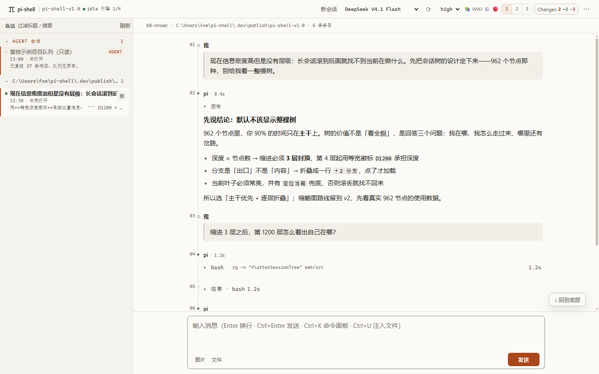
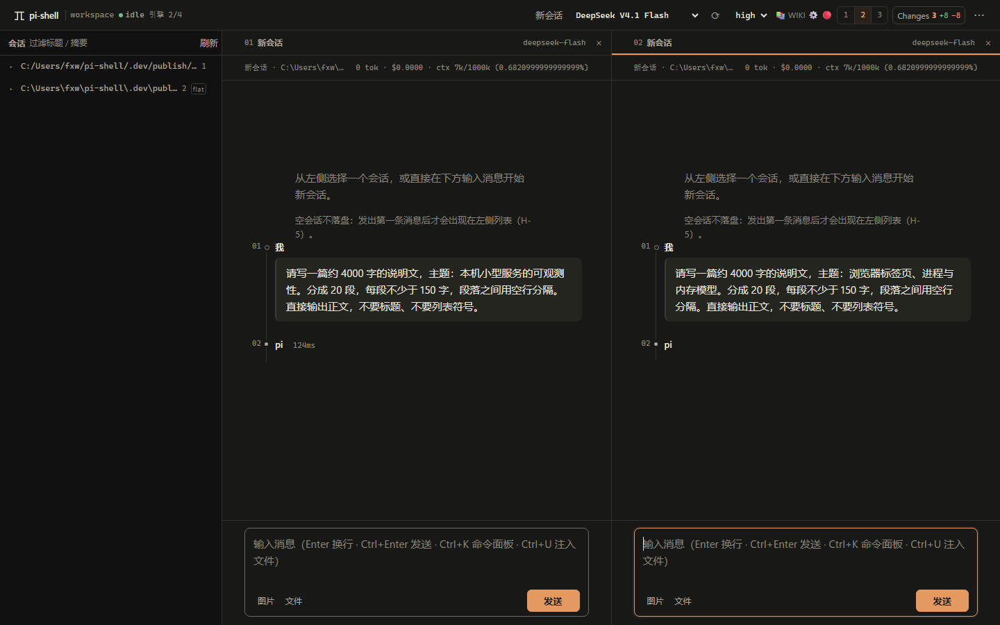
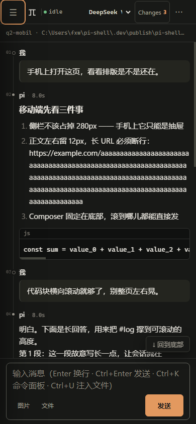

# pi-shell 使用手册（v1.0.0）

> 一句话：**把你终端里的 pi，搬到浏览器里用**。配置、扩展、会话、模型全都不变，只是多了一个能读长文、看表格、翻历史、还能多列并行和手机看的界面。
>
> **维护约定**：每次小版本发版（`x.Y.0`）必须同步更新本文（新功能 / 新快捷键 / 新排障条目），见 `docs/RUNBOOK.md` §3。


---

## 1. 它是什么 / 不是什么

**是什么**
- 一个跑在你本机的网页界面：桌面用 `http://127.0.0.1:7788`；装了 Tailscale 还会自动多给一个手机地址 `http://100.x.y.z:7788`
- 底层还是你装好的官方 pi 1.5.0，用的是同一份 `~/.pi/agent`（同一批扩展、同一个模型配置、同一批会话文件）
- 可以在网页里翻昨天的会话、继续追问、跑你的 `/skill:` 技能、**同时开 2–3 列**跑不同会话、看 AI 这一轮改了哪些文件

**不是什么**
- 不是第二套 AI 引擎（没有另装 pi，也不复制配置）
- 不是云服务（默认只监听本机 `127.0.0.1`，不联网、不要账号、不上传任何内容）
- 不是 IDE（能看和用，不做代码编辑）
- 不会替换终端：终端照旧可用，两边共存（**但同一个会话不要同时开到两边**，见 §9）

---

## 2. 为什么做它

| 以前的麻烦 | 现在 |
|---|---|
| 长对话在终端里滚得难受、工具输出一大片 | 工具调用折叠成一行（带耗时），点开看参数/结果；thinking 默认收起 |
| 想找"昨天那轮对话"要翻目录、敲 resume | 左侧按项目分组列会话，点一下就打开；顶部还能过滤标题/摘要 |
| 表格、长文档、图片只能看文字 | Markdown 正常渲染，图片直接显示 |
| 一个任务跑着，想同时干另一件事 | 开 2–3 列，每列一个独立引擎，**同时 streaming 互不打断** |
| 不知道 AI 这一轮到底动了哪些文件 | 顶栏 `Changes` → 「本轮」：第 N 轮 · 改了哪几个文件 · 内联 diff |
| 想躺床上看一眼进度 | 手机装 Tailscale，打开 `http://100.x.y.z:7788`（默认已开） |

---

## 3. 我要开始用（启动 / 停止 / 重启）

### 3.1 启动
双击桌面上的 **`pi-shell`** 快捷方式。桥约 1–2s 就绪，浏览器会在 3s 后**自动打开**；没自动开就手动访问 `http://127.0.0.1:7788`。

- 重复双击不会起第二个桥：已在运行时只把浏览器叫到前台（提示 `already running`）。
- 启动窗口里出现 `mobile over Tailscale: http://100.x.y.z:7788` 就是手机地址也开了（见 §7）。

### 3.2 停止
**关掉那个 cmd 窗口**（或 Ctrl+C）就是停。页面会显示"桥不可达"，这是正常的。

### 3.3 重启
三种都行：

1. 顶栏 `⋯` → **重启桥**（推荐：会先确认，然后遮罩"桥正在重启…"，成功后自动刷新页面）；
2. 桌面快捷方式 **「重启 pi-shell」**（不用找 cmd 窗口）；
3. 关窗再双击 `pi-shell`。

崩溃会自愈：桥异常退出时启动脚本按 1s/2s/4s 退避重启（5 分钟内最多 3 次），记录在 `logs/launcher.log`；**关窗 / Ctrl+C 是正常停止，不会重启**。5 分钟内崩第 4 次会停在"重启超限"状态，需要手动重启桥。

> 用 `node bridge\src\index.mjs` 手动起的桥**没有**自愈循环，退出也不会自动回来；页面上的「重启桥」也救不了它（遮罩会提示去双击桌面快捷方式）。

---

## 4. 界面导览

实际界面：




```
┌──────────────────────────────────────────────────────────────────────────────┐
│ π pi-shell │ 工作区路径 │ idle │ 引擎 1/4 │ 新会话 │ 模型▾ │⟳│ 思考▾ │ 1 2 3 │ Changes 3 │ ⋯ │
├──────────────┬───────────────────────────────────────────────────────────────┤
│ 会话（侧栏）   │ 列 01 · 标题 · 模型 · MCP·N                                   │
│ ┌ AGENT 会话  │ ┌ 会话条（模型/思考/统计）                                     │
│ ├ 项目 A      │ │ 你 › …                                                       │
│ └ 项目 B      │ │ ● assistant …（左轨 + 序号 + 状态点）                          │
│  搜索 / 刷新   │ │ ▸ 工具 read_file · 603ms                                     │
│              │ │ ▾ tool_result …                                              │
│              │ └ Composer（图片 / 文件 / 中止 / 发送）                          │
└──────────────┴───────────────────────────────────────────────────────────────┘
```

### 4.1 顶栏：8 个常显位置 + `⋯`

| 位置 | 作用 |
|---|---|
| `π pi-shell` | 回首页（= 新会话；当前会话仍在左侧列表里） |
| 工作区路径 | 当前列的 cwd（中间省略，hover 看全路径） |
| 状态胶囊 | `idle` / `streaming 12s`（跳秒）/ `disconnected` / `failed` |
| `引擎 1/4` | 本页占用的引擎数 / 上限（超了会提示） |
| 新会话 | 新建：**先弹「选择项目」**（选已有目录或手输）→ 在该目录开新会话；**发第一条消息才落盘**；正在生成时拒绝 |
| 模型 ▾ + `⟳` | 只列**已配置**的模型；`⟳` 热刷新（不重启桥）；显示的是**当前列会话**的模型 |
| 思考 ▾ | off / low / medium / high… 按**当前列会话**的真实值回填 |
| `1 2 3` | 分栏：1–3 列（≤768px 隐藏，改用列切换器） |
| `Changes 3` | 有改动才出现：本轮改动文件数，或工作区 `git status` 计数 + `+A −B` |
| `⋯` | 树 / 文件 / Diff / 命令面板 / **MCP** / 设置 / 重启桥 + pid / pi 版本 / cwd |

> 找不到按钮时先点最右边的 `⋯`——"树 / 文件 / Diff / 设置 / 重启 / 命令面板"都收在菜单里。

### 4.2 侧栏
- 三行式：标题（= 会话第一条你的话）/ 时间·状态 / 末条摘要；**默认分组收起**（每次打开页面不会自动展开）。
- 顶部 **AGENT 会话（N）** 独立板块：AI 派生的会话会集中在这里，带 `AGENT` 徽标与左侧强调边（判定机制见 ARCHITECTURE §4）。
- 搜索框只过滤标题与摘要（不读大文件，这是刻意的）；`>200` 项自动虚拟化。
- 侧栏宽度可拖（260–520，默认 320），**双击分割线**恢复默认，宽度记在浏览器里。


### 4.3 消息流
- 1px 左轨 + 自动序号 + 角色状态点；thinking 与工具调用**默认折叠**。
- 只有本来就在底部才自动跟随；上滚后右下角浮出「↓ 回到底部」。
- 长会话懒加载：先末 100 条，向上滚动继续取。

---

## 5. 我要同时干几件事（多列并行）




**怎么开**：顶栏点 `2` 或 `3`（也会显示列头）。每列**独立**：

- 自己的引擎（`clientId = <标签页>#cN`）、自己的会话、自己的滚动、自己的 Composer、自己的 SSE；
- 多列可以**同时 streaming**——A 列跑长任务时，B 列照样能发消息（这才是"并发 = 列"的意义）；
- 列头显示 `01` / 标题 / 模型 / `MCP·N` / `×`（关闭该列；该列正在生成会先确认）。

**上限**：列最多 3，引擎默认最多 4（`PI_SHELL_MAX_ENGINES` 可改）。第 4 列会提示"已达列上限"。

**窄屏（≤900px）**：只显示当前列，顶部出现 `01 / 02 / 03` 切换器；**后台列继续收事件**（切换器上的点会闪），切回来接着看。

**什么时候该收成 1 列**：每个引擎常驻约 **90MB**（默认不带 MCP）。3 列同开 ≈ 3 倍；如果你只是"留着待会看"，请关掉那列（`×`）——关掉后桥会在 60s 空闲后回收它的引擎。**正在生成的那一列例外**：关掉不会中止，这一轮在后台跑完才进入 60s 空闲回收。


---

## 6. 我要手机上看 / 发一句话（Tailscale）


**默认已经开好了**（用桌面快捷方式启动时）：

- 启动脚本检测到本机有 `tailscale ip -4` 的 `100.x`，就自动 `PI_SHELL_BIND=tailscale`；
- **双栈**：同一端口同时监听 `127.0.0.1` 和 `100.x`——桌面照旧 `http://127.0.0.1:7788`，手机用 `http://100.x.y.z:7788`；
- 手机装 Tailscale、用**同一个账号**登录，浏览器打开那个地址即可（页面是同一套，≤768px 自动变抽屉 + 单列 + 固定输入框）。

实际界面（手机 · 单列；☰ 打开侧栏抽屉，点遮罩或 Esc 关闭）：



**怎么知道地址**：启动窗口的 `mobile over Tailscale: …` 一行；或跑
`powershell -NoProfile -ExecutionPolicy Bypass -File scripts\tailscale-setup.ps1`（只读，打印地址与排查清单）。

**怎么关掉**：
- 临时：设 `PI_SHELL_NO_TAILSCALE=1` 再启动（或显式 `set PI_SHELL_BIND=127.0.0.1`）；
- 桌面**不受影响**：两种模式下 `127.0.0.1:7788` 都可用（`PI_SHELL_BIND=100.x.y.z` 这种显式单地址写法例外——那时只有手机地址）。

**边界**：只走加密 tailnet，不开公网、不做端口转发；`PI_SHELL_BIND=0.0.0.0` 会**拒绝启动**（除非你显式 `PI_SHELL_ALLOW_LAN=1`）。手机丢了就去 Tailscale 管理台把那台设备移除。完整步骤见 `docs/RUNBOOK.md` §6。

---

## 7. 我要翻分支 / 从某句话重开（会话树）

点 `⋯` → **树**。

- 默认**主干视图**：当前最后一条消息的父链一路展开，兄弟折叠成一行"分支（N 条）"摘要，点开分页加载。
- 深层嵌套不会崩：缩进最多 3 层，更深的用 `D<层号>` 徽标表示（实测 949 层可读）。
- 工具条：跳到当前叶子 / 展开全部（分页，上限 4000 行）/ 折叠全部 / 搜索（`输入 → Enter`）。


**单击**选中（只高亮，不动主对话）→ 底部信息条显示角色 / 时间 / 耗时 / token / 摘要，旁边三个按钮：

| 按钮 | 作用 |
|---|---|
| 在对话中定位 | 主对话滚到那条并高亮（跨分支节点也能定位） |
| 从此处继续 | `fork` 出新会话——**只对"你的消息"可点**，AI 的消息不能分叉（按钮禁用 + tooltip） |
| 复制消息 | 把该节点文字写进剪贴板 |

**双击**节点 = 在对话中定位。**键盘**：`j` / `k` 上下选、`Enter` 定位、`f` 从此处继续、`/` 聚焦搜索。

**仅看分支点**：只留"你的消息 / 分叉点 / 叶子"（实测 17 → 9 节点），按钮变成「看全部节点」可随时切回。


---

## 8. 我要看清 AI 干了什么（工具耗时 / 本轮改动）

### 8.1 工具行
- 每行显示**完成耗时**（`· 603ms`），运行中每 200ms 跳秒；数字等宽不抖行。
- **失败**的工具耗时固定，旁边标「失败」（红）；父行不会被有失败的子调用误标。
- **嵌套调用**默认折叠成父行右侧「+N 个子调用」，点开子行缩进一级。


> 历史会话没有 `durationMs` 字段时，耗时用条目时间戳近似（hover 会说明）。

### 8.2 本轮改动面板

点顶栏 **Changes**（有改动才出现）→ 面板默认打开 **「本轮」**：

- 摘要「第 N 轮 · M 个文件」，每行 `A` 新增 / `M` 修改 / `D` 删除 + `+A −B` + **内联 diff**；
- 切到 **「工作区」** 页 = 当前 `git status` 的改动（与终端一致）；
- 这一轮没改文件 → 明确空态「这一轮没有文件改动」（不拿工作区数据冒充）。


**它怎么来的**：桥对 write/edit 类工具在**执行前后各抓一份文件内容**，diff 是读的时候现算的（`git diff --no-index`）。所以对工作区**是只读的**，不会替你 stage/commit。

**注意**：每会话只留最近 **20 轮**快照（更早的自动清）；单轮 ≤50 个文件存内容、单文件 ≤2MiB、总 ≤50MiB，超限只记路径（面板会说明"无法生成 diff"）。

---

## 9. 我要换模型 / 换思考级别

- 顶栏「模型 ▾」**只列已配置的模型**（认 `auth.json` / `credentials.env`；环境变量里的假 key 不算）。按 provider 分组。
- 列表里没有你想要的：先在配置文件里补好，再点 **`⟳`**（热刷新，不重启桥）。如果模型表变了但当前引擎还没跟上，会提示「模型表已变，点头部『重启』生效」。
- **思考级别**按该会话真实值回填，刷新页面不会被重置成 `off`。
- 每一项都是**按列**的：A 列用 GPT、B 列用 Claude 是正常状态。
- **顶栏显示的是当前列会话的真实值**：切列后模型 / 思考级别 / MCP / 项目目录一起跟着换，不会停在上一个会话的值。


---

## 10. 我要用 MCP（代码图谱 / Obsidian / …）

**默认不带任何 MCP。** 新列/新标签页的引擎一律以 `--no-mcp` 启动（省内存、切换快）。

- 单引擎整棵树 ≈ **90MB**（对比全开 codegraph + Obsidian 的 ≈**544MB**）；
- 切换会话 ≈ **0.15s**（对比 ≈2.7s）。

**要用时**：点 `⋯` → **MCP** → 面板里**逐个勾选**（codegraph / mcp-obsidian / bilibili…）。

- 只对**当前列**生效；勾选会**重启本列引擎（约 1 秒）**，**会话不变**（会切回原会话文件）；
- 列头出现 `MCP·1`（hover 看名单），`⋯` 上也有数量徽标；
- 全部关掉 → 回到 `--no-mcp`，临时目录同时删除；
- 重启失败或原会话已被删 → 提示「已重启，但没能恢复原会话（已落新会话）」；
- 该列正在生成回答时不让切（先中止）。


### 10.1 让它按目录自动开（可复制）

配置文件：`~/.pi/agent/pi-shell-mcp.json`（不是 `mcp.json`；`PI_SHELL_MCP_CONFIG` 可换路径）。文件不存在就等于"默认全关"。

```json
{
  "default": [],
  "rules": [
    { "cwd": "C:\\Users\\user\\my-project*", "servers": ["codegraph"] },
    { "cwd": "D:\\notes\\*", "servers": ["mcp-obsidian"] },
    { "cwd": "D:\\work\\*", "servers": ["codegraph", "mcp-obsidian"] }
  ]
}
```

- `default`：都不命中时用；留 `[]` = 默认全关。
- `rules`：按**会话 cwd** 通配（`*` 任意串、`?` 单字符），**首条命中即止**，大小写不敏感；`servers` 写 `[]` 表示"这个目录明确不带"。
- **手动勾选优先**于规则；规则只在**建引擎/重启引擎**时生效——改完文件后**新开一列**即可验证。
- server 的名字/命令/参数仍来自 `~/.pi/agent/mcp.json`（面板只勾选，不编辑定义）；写了不存在的名字会被静默忽略（桥日志有 `mcp_shim_unknown_server`）。

> 也可以直接调接口写（带 schema 校验，非法 400 不落盘）：
> `curl.exe -X POST -H "Content-Type: application/json" --data @rules.json http://127.0.0.1:7788/api/mcp/config`

---

## 11. 键盘快捷键总表

| 键 | 作用范围 | 作用 |
|---|---|---|
| `Enter` | 输入框 | **换行**（`Shift+Enter` 同样换行） |
| `Ctrl/⌘ + Enter` | 输入框 | **发送**（输入法组词中的回车不会误发） |
| `Ctrl/⌘ + K` | 全局 | 命令面板（扩展命令 / 提示词模板 / 技能） |
| `Ctrl/⌘ + U` | 全局 | 注入文本文件（≤200KB） |
| `Esc` | 全局 | 优先级：确认框 = 取消 → `⋯` 菜单开着 = 关菜单 → 移动端抽屉开着 = 关抽屉 → 否则 = 中止当前列的回答（先清队列再中止） |
| `j` / `k`（或 `↓` / `↑`） | 会话树 | 上下移动选中节点 |
| `Enter` | 会话树 | 在对话中定位选中节点 |
| `f` | 会话树 | 从此处继续（fork，仅 user 节点） |
| `/` | 会话树 | 聚焦搜索框 |
| `Enter` / `↓` / `↑` | 树搜索框 | 下一个 / 上一个命中（`Esc` 清空） |

命令面板里三类来源都在：扩展命令、提示词模板、技能（显示 `skill:名字`，点选即发送 `/skill:名字`）。


---

## 12. 我要调外观

`⋯` → **设置**：主题（跟随系统 / 亮 / 暗）、密度（舒适 / 紧凑）、字号（13 / 15 / 17px）、显示快捷键提示。「恢复默认」一键重置。偏好存在浏览器 localStorage，刷新保持。


> 暗色下 `select / option` 的文字色是显式配的（不会白底白字）；滚动条也有暗色配色。

---

## 13. 扩展要我回答时

扩展要问你（选择 / 确认 / 输入 / 多行编辑）时，网页弹模态框，点完回传给 pi；`notify` 显示为提示条，`setStatus` 进状态条，`setWidget` 显示在输入框上方。关掉页面时若还有未回执的弹窗，**10 秒后**自动按"取消"处理。


RPC 模式的降级：整块自定义面板、footer/header、主题切换等在网页里**无效**（pi 的限制，不是 bug）。

---

## 14. 常见问题

| 现象 | 先看这里 |
|---|---|
| 页面打不开 | 桥没起来 / 端口被占：看启动窗口，`7788 被占用` 会明确报错（**不会**自动换端口） |
| 页面显示"桥不可达" | 桥进程退出了（关窗就是停）。重开快捷方式或点 `⋯` → 重启桥；页面会自己重连 |
| 会话列表是空的 | 扫描目录不对（默认 `~/.pi/agent/sessions`），或那里确实没有 `.jsonl`；也可能是**全部被判定为 test**（拍一张 `GET /api/sessions` 看看） |
| 输入框是灰的 | 正在"接管"会话：默认无 MCP 约 0.2s，勾了 MCP 会 1–3s；看横幅是否提示接管失败 |
| 提示"引擎已达上限（4）" | 页面占满了引擎（每列一个 + 其它标签页）。关掉用不着的列/标签页，或等 60s 空闲回收；`PI_SHELL_MAX_ENGINES` 可调 |
| 提示"已达列上限（最多 3 列）" | UI 上限就是 3；想同时看更多会话请用另一个标签页 |
| 提示"该会话已在另一个标签页打开" | 同一个会话被别处占着（409）。在那边关掉，或换一个会话——**不要双开**。如果是刚关掉标签页/列想回来：**等约 30 秒**再打开同一会话，桥会自动接管仍在后台跑的那条引擎 |
| 新会话落在哪个目录 | 点「新会话」先弹「选择项目」：候选来自已有会话的目录 + 你最近用过的 5 个，也可以「其他目录…」手输。换目录只重启当前列（约 1–3 秒） |
| 关掉标签页/列后，刚才那一轮还在跑吗 | **在跑**：流式中的引擎不会被 60s 空闲回收（只有超过 2 小时才兜底强收）。回来打开同一会话即可补齐；但**界面内「重启桥」/关掉启动窗口仍然会释放全部引擎** |
| 内存高 | 看开了几列 × 每列是否勾了 MCP（`⋯` → MCP）；默认无 MCP ≈90MB/引擎，勾 2 个 server 会到几百 MB。收成 1 列 + 关掉不用的标签页最有效 |
| 手机连不上 | ①本机 `tailscale ip -4` 有没有 `100.x`；②手机是不是同一账号/同一 tailnet；③桥是否在跑；④启动窗口有没有打印 `mobile over Tailscale`；⑤`curl http://100.x.y.z:7788/api/health` 通不通 |
| 手机打开是白屏/很挤 | 窄屏本来就只显示当前列 + 抽屉；宽表格/长代码块体验一般（网页布局限制，不是桥的问题） |
| 勾了 MCP 但工具还是不可用 | `GET /api/health` 看 `engines[].mcp` 里有没有那个名字（**数组**）；没有 = 没生效，重启本列引擎；有但工具缺 = server 自己起不来（看桥日志 `pi_stderr`） |
| Changes 里没东西 | 「本轮」只认 write/edit 类工具的快照；旧会话或没改文件就是空态。工作区改动看「工作区」页 |
| 工具栏耗时不对 | 历史会话没有 `durationMs`，是**按时间戳近似**的（hover 会说明） |
| pi 连续崩溃后不再重启 | 5 分钟内超 3 次会转入"重启超限"，需要手动重启桥 |
| 状态灯/自定义面板不显示 | 见 §13：RPC 模式下这些扩展 UI 是 no-op |
| 想彻底不用了 | 见 §16 卸载 |

---

## 15. 隐私与安全

- 默认只监听本机回环；页面没有账号、没有 cookie 登录、不加载任何外部资源（无 CDN、无外链字体）。
- 不读你的密钥文件；模型请求由 pi 自己发出。
- 日志只记动作（方法/路径/状态/耗时/事件名），**不记消息正文**，并对 `sk-` / `tvly-` 类密钥做兜底脱敏。
- 会写的地方：pi 自己写的会话文件与 `settings.json` / `models-store.json` / `state/`；pi-shell 自己的 `backups/`（删除的会话、本轮快照）与 `logs/`。
- **能连到端口的人就能操作 pi**（无认证）：桌面靠回环，手机靠 tailnet——tailnet 就是边界。

---

## 16. 卸载 / 回滚

1. 停掉桥（关窗口，或按端口结束 node 进程）。
2. 删除项目目录（整个 `pi-shell` 文件夹）。
3. 删除桌面快捷方式 `pi-shell.lnk` 与「重启 pi-shell」。
4. 会话备份在项目目录之外（`pi-shell-backup/`），**卸载不会删它**；确认不用了再手动删。
5. 若怀疑会话被写坏：用备份目录里对应日期的 `sessions-backup-*` 覆盖 `~/.pi/agent/sessions` 下对应文件。
6. 如果之前跑过 Tailscale 防火墙脚本：`Remove-NetFirewallRule -DisplayName "pi-shell Tailscale 7788"`。

---

## 17. 相关文档

| 想了解 | 看哪里 |
|---|---|
| 每个版本你感受到的变化 | `docs/WHATS-NEW.md` |
| 架构与代码地图 | `docs/ARCHITECTURE.md` |
| 怎么运维/排障/发布/回滚/手机访问/MCP | `docs/RUNBOOK.md` |
| 做了什么、有什么限制 | `RELEASE-NOTES.md`、`CHANGELOG.md` |
| 契约（端点/错误码/硬事实） | `docs/03-design.md` |
| 视觉与组件规范 | `docs/DESIGN-SYSTEM.md`、`docs/design/LAYOUT.md` |
| 验收证据脚本 | `scripts/evidence/` |

## 18. 资源与多窗口

- **复制标签页**：复制出来的页面会自动换成独立身份，不再和原页面抢同一个后台；两边可以同时跑，互不打断（同一会话仍只能在一个页面里发消息）。
- **看谁在吃内存**：`⋯` →「资源」
  - 每一列一行：会话标题 / 模型 / 状态 / MCP / 占用 / 空闲时长；
  - **正在生成**的列状态是 `streaming`（不会显示成「空闲」，也不会被 60s 回收）；
  - 行内「释放」= 关掉这一列的后台（会话文件不丢，重新点开会话即可恢复；**正在跑的回合会被中止**）；
  - 「关 MCP」= 让这一列回到轻量模式（约 90MB，失去 codegraph/obsidian 工具）；
  - 顶部「只留当前列」= 一次性释放其它列（会二次确认）。
- **日志占用**：`logs/` 默认每 5MB 轮转、保留 5 份；想手动清一次：`node scripts/rotate-logs.mjs --dry-run` 先看，再去掉 `--dry-run`。

---

## 19. 新会话选项目 + 切走不中断

### 19.1 新会话先选目录

点顶栏「新会话」→ 弹出「选择项目」：

- 列表里是**已有会话用过的目录**（按最近使用排序）+ 你最近选过的 5 个；
- 都不是？点「其他目录…」直接粘路径（`C:\...` 与 `C:/...` 都行）；
- 选中确认 → 在当前列**那个目录**开新会话（换目录时这一列重启一次，约 1–3 秒；其它列不受影响）；
- 取消 = 什么都不做。新会话仍然**发第一条消息才落盘**。

### 19.2 顶栏跟着会话走

模型 / 思考级别 / MCP / 项目目录都是**会话的属性**：切到哪一列，顶栏就显示哪一列的真实值；模型下拉的选项也按那一列取。不再出现“切了列，顶栏还停在上一个会话的模型”这种情况。

### 19.3 切走 / 关标签后回来

- **切到别的窗口/标签**：这一轮照常跑（后台不中止）。
- **关掉标签页或关掉那一列**：正在跑的那一轮**继续在后台运行**，不会被 60 秒空闲回收（只有超过 2 小时才会兜底强收，并在日志里记 `engine_pin_expired`）。
- **回来**：重新打开这条会话 → **等待约 30 秒**（接管门槛，避免和刚断线的页面抢）→ 桥把那台还在跑的引擎交给你，页面自动重连并**补齐未落盘的那段输出**；回合结束后会自动和正式记录对齐一次。
- **极长输出**：单轮尾巴有上限（默认 2MB），超出时会提示「部分输出未能补齐」——已落盘的内容不受影响。

### 19.4 仍然会丢的场景（说清楚）

- **桥进程重启**（界面 `⋯` → 重启桥、关掉启动窗口、崩溃后重启）：全部引擎都会被释放，正在跑的那一轮会丢。
- **后台回合恰好在等工作中的权限确认**：没有页面连着，10 秒后自动按“取消”处理。
- **约 30 秒内立刻回来**：仍提示“该会话已在另一个标签页打开”，等一会儿再开即可。

